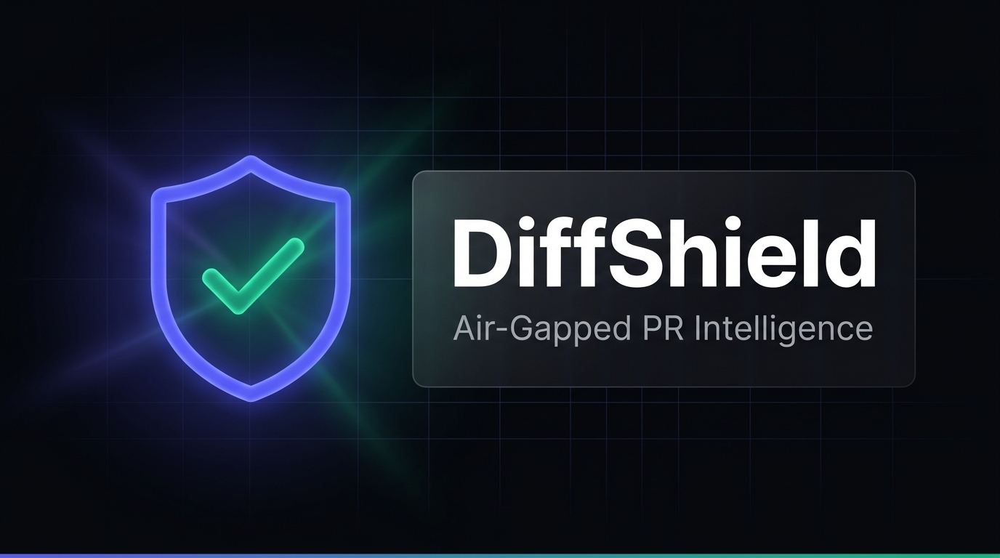
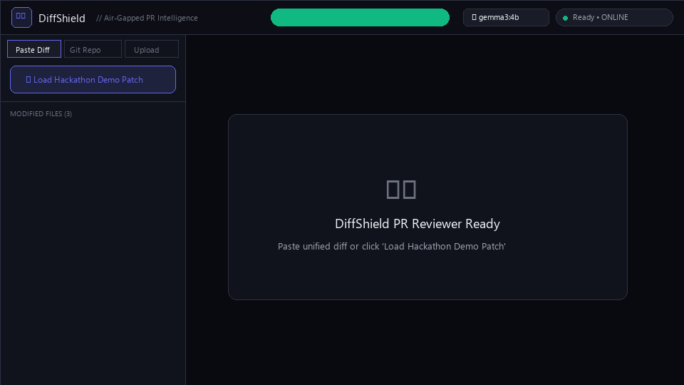
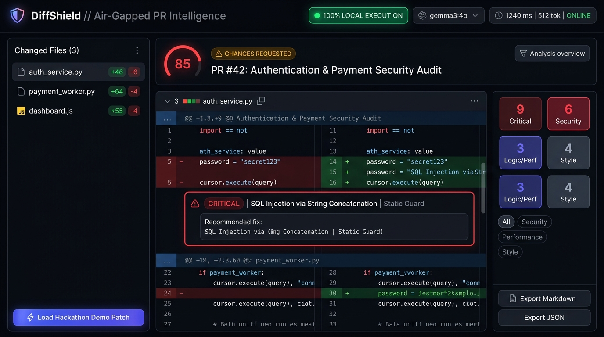
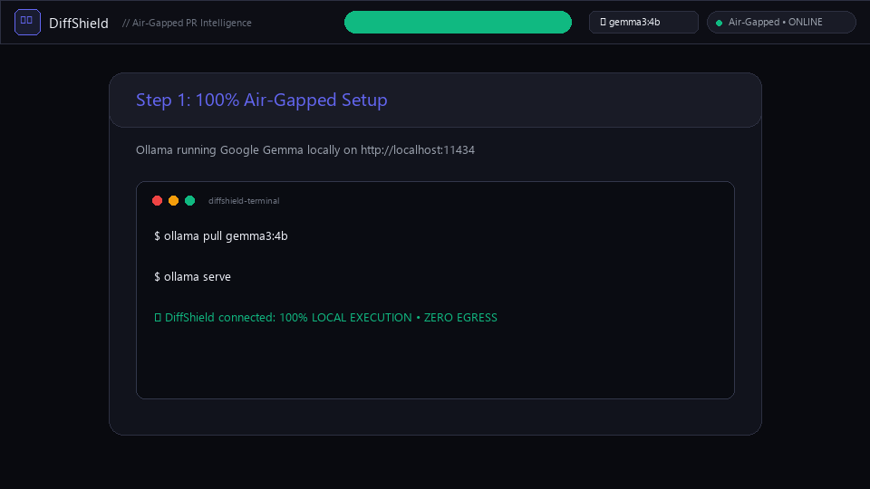
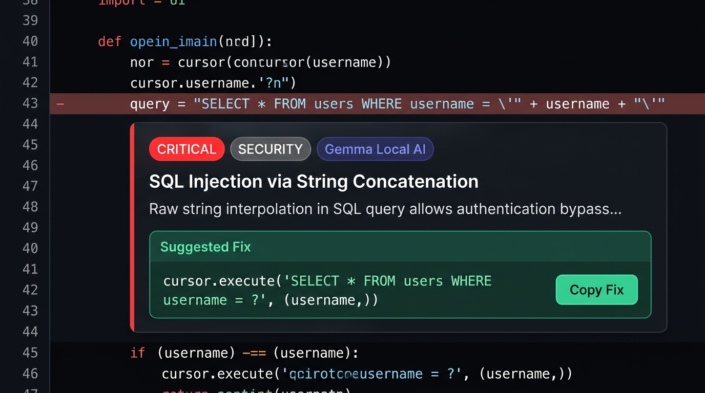
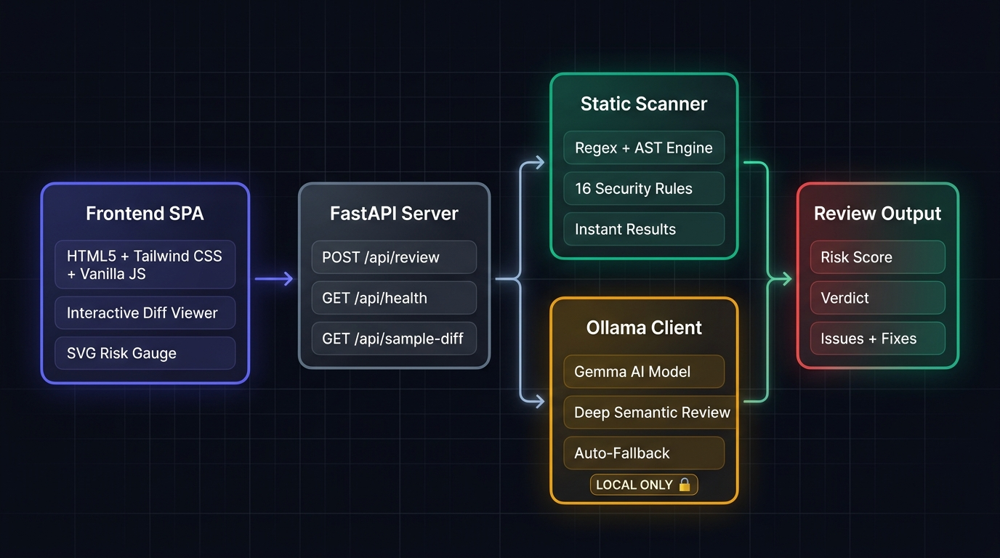

<p align="center">
  
</p>

<p align="center">
  <a href="#-features"></a>
  <a href="#-local-ollama-model-integration"></a>
  <a href="#-offline--zero-cloud-egress"></a>
  <a href="#-license"></a>
</p>

<h1 align="center">DiffShield // Air-Gapped PR Intelligence</h1>

<p align="center">
  <strong>Problem Statement #17: Local, Private Pull Request Reviewer</strong><br/>
  An elite, Silicon Valley-grade code review platform running <strong>100% offline</strong> with zero cloud egress. Powered by local <strong>Google Gemma</strong> via Ollama with an instant deterministic AST + Regex Security Guard fallback engine.
</p>

---

## ⚡ Live Demo Walkthrough

See DiffShield in action reviewing a pull request, flagging high-severity SQL injections & hardcoded credentials, and providing one-click remediations:

<p align="center">
  
</p>

---

## 📸 Flagship Cyber-Obsidian UI

Crafted with a **Cyber-Obsidian** dark mode palette, backdrop glassmorphism, animated SVG risk gauges, and unified diff inspection:

<p align="center">
  
</p>

---

## 💡 How To Use DiffShield

<p align="center">
  
</p>

### Ingestion Methods
1. **⚡ One-Click Hackathon Demo**: Click the prominent glowing button to instantly load `sample_diff.patch` (3 modified files with multi-language bugs).
2. **📋 Paste Diff**: Paste any `git diff` output directly into the unified textarea.
3. **📂 Scan Local Git Repo Path**: Provide a local filesystem path (e.g., `C:/path/to/my-repo`) to inspect unstaged or committed changes automatically.
4. **📎 Upload .patch File**: Drag and drop any `.patch` or `.diff` file onto the dashboard.

---

## 🔍 Inline AI Review & One-Click Remediation

DiffShield injects context-aware review cards directly beneath problematic code lines, featuring exact line attribution, severity badges, and copyable fixes:

<p align="center">
  
</p>

- **Severity Tiers**: `CRITICAL` (Crimson Pulse), `WARNING` (Amber Glow), and `NITPICK` (Electric Indigo).
- **Dual Source Attribution**: Clear distinction between `Gemma Local AI` (semantic analysis) and `Static Guard` (deterministic AST patterns).
- **Actionable Fixes**: Click **"Copy Fix"** to immediately copy the recommended patch into your clipboard.
- **Export Options**: 1-click **"Export PR Review (.md)"** or **"Copy GitHub Comment"** with pre-formatted markdown.

---

## 🏗️ Architecture & Air-Gapped Flow

<p align="center">
  
</p>

```
┌────────────────────────────────────────────────────────────────────────┐
│                        DiffShield Architecture                         │
├────────────────────────────────────────────────────────────────────────┤
│                                                                        │
│   ┌──────────────┐     ┌──────────────┐    ┌───────────────────────┐   │
│   │ Frontend SPA │ ──▶ │ FastAPI App  │ ─▶ │ Hybrid Review Engine  │   │
│   │ HTML5 / CSS  │     │ main.py      │    │ core/reviewer.py      │   │
│   │ Vanilla JS   │ ◀── │ /api/review  │ ◀─ │                       │   │
│   └──────────────┘     └──────────────┘    │ ┌───────────────────┐ │   │
│                                            │ │ Static Scanner    │ │   │
│                                            │ │ (Deterministic)   │ │   │
│                                            │ └───────────────────┘ │   │
│                                            │ ┌───────────────────┐ │   │
│                                            │ │ Ollama Client     │ │   │
│                                            │ │ (Gemma 3 / 2)     │ │   │
│                                            │ └───────────────────┘ │   │
│                                            └───────────────────────┘   │
│                                                        │               │
│                                                        ▼               │
│                                              ┌───────────────────┐     │
│                                              │ Local Ollama API  │     │
│                                              │ :11434 (AIR-GAP)  │     │
│                                              └───────────────────┘     │
└────────────────────────────────────────────────────────────────────────┘
```

---

## 🛡️ Deterministic Static Guard Rules

Even if the local Ollama instance is offline, our deterministic engine catches 16+ high-risk categories in milliseconds:

| Rule ID | Category | Detection Target | Default Severity |
| :--- | :--- | :--- | :--- |
| **SEC-001** | Security | Hardcoded AWS Access Keys (`AKIA...`) | `CRITICAL` |
| **SEC-002** | Security | Exposed API tokens, JWT secrets, Stripe secrets | `CRITICAL` |
| **SEC-003** | Security | Hardcoded cleartext passwords | `CRITICAL` |
| **SEC-004** | Security | Live Stripe Secret Keys (`sk_live_...`) | `CRITICAL` |
| **SEC-010** | Security | SQL Injection via raw string concatenation/formatting | `CRITICAL` |
| **SEC-020** | Security | Arbitrary code execution via `eval()` | `CRITICAL` |
| **SEC-021** | Security | Dangerous execution via `exec()` | `CRITICAL` |
| **SEC-022** | Security | Shell injection via `subprocess.run(..., shell=True)` | `CRITICAL` |
| **SEC-023** | Security | DOM XSS via raw `.innerHTML` assignment | `WARNING` |
| **SEC-024** | Security | Insecure JWT verification using `algorithms=['none']` | `CRITICAL` |
| **PERF-001**| Performance | $O(n^2)$ nested loops over collections (Python) | `WARNING` |
| **PERF-002**| Performance | $O(n^2)$ quadratic loop nesting in JavaScript | `WARNING` |
| **LOG-001** | Code Quality | Unresolved `TODO` / `FIXME` / `BUG` markers | `NITPICK` |
| **LOG-002** | Reliability | Overly broad exception clauses (`except Exception:`) | `WARNING` |
| **LOG-003** | Reliability | Swallowed errors (empty except / catch-console only) | `WARNING` |
| **LOG-010** | Memory | Unhandled `setInterval` leaks without teardown | `WARNING` |

---

## 🚀 Quick Start Guide

### 1. Clone & Install
```bash
git clone https://github.com/KrishnaBharadwaj67/gemma-pr-sentinel.git
cd gemma-pr-sentinel
pip install -r requirements.txt
```

### 2. (Optional) Run Local Google Gemma via Ollama
Ensure you have [Ollama](https://ollama.ai) installed and pull your preferred Gemma model:
```bash
# Pull Google's lightweight Gemma model
ollama pull gemma3:4b
# or: ollama pull gemma2:2b / gemma:7b
ollama serve
```
*(Note: If Ollama is not running, DiffShield seamlessly engages its instant Static Guard engine without crashing!)*

### 3. Launch DiffShield Server
```bash
python main.py
```
Open your browser at **`http://localhost:8000`**.

---

## 📡 API Specification

### `POST /api/review`
Reviews code diffs using the hybrid pipeline.

```json
// Request
{
  "diff_text": "diff --git a/auth.py b/auth.py...",
  "model": "gemma3:4b",
  "repo_path": null
}

// Response
{
  "review": {
    "summary": "Critical vulnerabilities detected in authentication and subprocess execution.",
    "risk_score": 85,
    "verdict": "BLOCKED_CRITICAL_RISK",
    "issues": [
      {
        "file": "auth_service.py",
        "line": 43,
        "severity": "CRITICAL",
        "category": "SECURITY",
        "source": "Gemma Local AI",
        "title": "SQL Injection via String Concatenation",
        "description": "Raw string interpolation in SQL query allows authentication bypass.",
        "suggested_fix": "cursor.execute('SELECT * FROM users WHERE username = ?', (username,))"
      }
    ]
  },
  "engine": "hybrid_ai",
  "telemetry": {
    "model": "gemma3:4b",
    "latency_ms": 182,
    "tokens_generated": 512,
    "status": "success"
  },
  "files": [
    { "path": "auth_service.py", "language": "python", "additions": 46, "deletions": 6 }
  ]
}
```

### `GET /api/sample-diff`
Returns the bundled multi-language hackathon test patch (`sample_diff.patch`).

### `GET /api/health`
Probes local Ollama connectivity (`http://localhost:11434/api/tags`) and reports model telemetry.

---

## 🎨 Design System Tokens

| Token | Value | Description |
| :--- | :--- | :--- |
| **Deep Obsidian** | `#090A0F` | Primary background canvas |
| **Glass Surface** | `rgba(17, 19, 28, 0.75)` | Frosted cards with 16px blur |
| **Electric Indigo** | `#6366F1` | Brand accents & AI detection pills |
| **Cyber Emerald** | `#10B981` | Approved verdicts & privacy status |
| **Crimson Pulse** | `#EF4444` | Critical risks & blocked merges |
| **Amber Glow** | `#F59E0B` | Security warnings & fallback indicators |

---

## 📄 License
This project is open-source software licensed under the **[MIT License](LICENSE)**.
